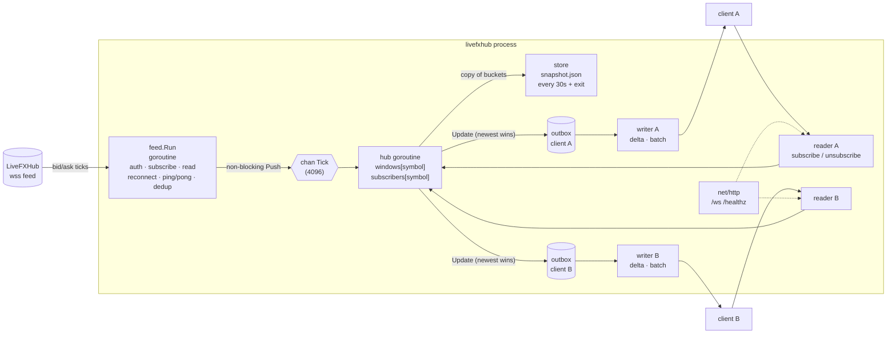

# Architecture

## Goroutines

| goroutine            | count        | owns                                   | talks to                          |
|----------------------|--------------|----------------------------------------|-----------------------------------|
| feed.Run             | 1            | the upstream socket, dedup state       | hub via `Push` (never blocks)     |
| feed ping            | 1 per conn   | –                                      | upstream socket (control frames)  |
| hub.Run              | 1            | all `window.Window`s, client registry  | client outboxes (mutex, µs)       |
| snapshot ticker      | 1            | –                                      | `hub.Snapshot()` then disk        |
| ws reader            | 1 per client | the client socket (reads)              | hub (subscribe), writer (acks)    |
| ws writer            | 1 per client | the client socket (writes), delta state| outbox                            |
| http server          | n            | –                                      | –                                 |

Rule: a socket has exactly one writer goroutine. The windows have exactly one owner.

## Data flow for one tick

1. `feed` reads a frame, parses `{symbol,bid,ask}`, drops it if identical to the previous tick
   for that symbol, stamps arrival time, `hub.Push`.
2. `hub` pops the tick, `window.Add(bid, at)` (O(1)), and if anyone is subscribed computes
   `window.Stats(at)` once and pushes an `Update` into each subscriber's outbox. A pending update
   for the same symbol is replaced.
3. Each `writer` wakes, drains its outbox (≤ 32 symbols per frame), diffs against what it last
   sent to that client, encodes the changed fields, writes one frame, records latency.

## Shutdown order (`main.go`)

SIGINT / SIGTERM / SIGHUP → cancel ctx
→ `feed.Run` returns (close frame sent upstream, otherwise the key stays locked server-side)
→ `http.Server.Shutdown` (5 s)
→ `hub.Run` returns (closes every client outbox → writers send close frames)
→ final `store.Save`.

## Persistence

`store.Snapshot{version, saved_at, symbols: {SYM: [bucket...]}}` as JSON. Written to a temp
file in the same directory, fsynced, then renamed over the target, so a crash mid-write cannot
leave a torn file. On start, buckets older than 24h are dropped; the rest are placed back into
the ring. In Docker the file lives on the `livefxhub-data` volume.
